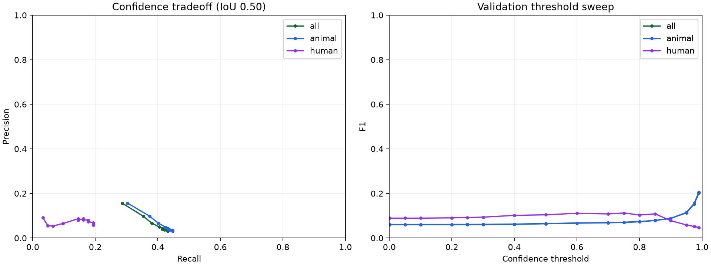

# Validation error analysis — October 29, 2026

Analyzed the saved epoch-7 checkpoint from completed run `20261029_133235_full` on all 334 development validation frames. Original TestReal was not read. No weights, inference defaults, or training behavior changed.

## Confidence filtering

The 0.25 baseline exactly reproduced the previously saved aggregate precision and recall. Predictions were generated once at confidence 0.001 and filtered at 17 thresholds. The existing 500-candidate limit, per-class NMS and 40-detection/image cap were preserved.

| Threshold | Precision | Recall | F1 | True positives | False positives |
|---|---:|---:|---:|---:|---:|
| 0.25 | 3.29% | 43.11% | 6.11% | 438 | 12,880 |
| 0.99 | 15.60% | 28.64% | 20.20% | 291 | 1,574 |

0.99 had the highest micro F1 among the tested thresholds. This is not a deployment recommendation or proof of an optimum: selection used the same development validation set, and 0.99 was the top end of the tested range. Filtering removes 87.8% of baseline false positives but loses 147 true positives.

| Class | Precision at 0.25 | Recall at 0.25 | Precision at 0.99 | Recall at 0.99 |
|---|---:|---:|---:|---:|
| Animal | 3.25% | 44.65% | 15.68% | 30.29% |
| Human | 6.03% | 19.35% | 9.09% | 3.23% |

A global high threshold severely hurts human recall: only 2 of 62 labeled human instances remain detected. Aggregate F1 is dominated by the more numerous animals. Do not change the default threshold to 0.99 on the basis of aggregate F1 alone.



## What the errors look like

At threshold 0.25, unmatched predictions were grouped using label overlap:

- 11,290 background-like: no annotated box with IoU at least 0.10.
- 1,512 localization-like: some label overlap at IoU at least 0.10, without a correct match at 0.50.
- 61 duplicates: same-class overlap at IoU at least 0.50 after the available label was matched.
- 17 class confusions: other-class overlap at IoU at least 0.50 after excluding duplicates.

These are exclusive diagnostic heuristics, not proof that every unmatched box is true background; annotations and localization can affect categories. Categories sum to the baseline's 12,880 false positives. There were also 578 missed labeled objects.

Visual inspection of one highest-FP frame per validation video shows repeated predictions across ground textures and some along the letterboxed image boundary. Several survive a confidence threshold of 0.99. The selected examples are deliberately difficult, not a representative random sample. Two additional human-heavy frames are saved separately.

## Recommended next experiment

The main issue is background rejection rather than duplicate suppression. The current objectness loss averages all negative cells and weights that term by 0.25, so numerous easy negative cells can dilute difficult false-positive regions. This is a hypothesis from the code and error pattern, not a confirmed causal finding.

Test a controlled hard-negative-mining or focal-objectness-loss variant against this frozen baseline. Keep data split, random seed, image size, training budget and evaluation settings fixed. Explicitly inspect letterbox-padding detections and annotation alignment before treating all unmatched boxes as negatives. Compare per-class precision/recall and AP, including human recall, before choosing an operating threshold. Keep official TestReal held out until model and threshold choices are finalized.

Do not repeat the identical training configuration as the next experiment; this analysis does not justify expecting a different outcome. No model improvement has been measured in this analysis.

## Files and reproduction

- [Threshold counts and scores](../records/experiments/20261029_133235_full/confidence_thresholds.csv)
- [Checkpoint fingerprint, aggregate results and diagnostic categories](../records/experiments/20261029_133235_full/error_analysis_summary.json)
- Local only: `training_runs/20261029_133235_full/error_analysis/predictions.json`, `validation_examples.png`, `human_examples.png`. These images contain BIRDSAI data and remain inside the Git-ignored run folder.

```powershell
py -3.12 -u analyze_validation.py --run training_runs/20261029_133235_full
```

The script uses CPU inference, writes analysis outputs under that run, and never retrains or overwrites weights. Existing five core tests passed. Controlled checks verified duplicate/class/background categorization, confidence filtering and missed-label handling; baseline reproduction and false-positive totals were also asserted during the full analysis.
