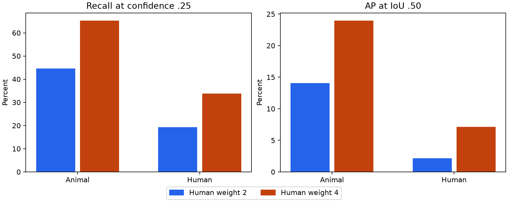

# Human class-weight experiment — November 2, 2026

Tested human class weight 2 (existing default) versus 4 with animal weight fixed at 1. Both runs trained from scratch on CPU with seed 42, baseline objectness, size 256, batch 4, AdamW learning rate .001, weight decay .0001 and ten epochs. Same 2,001 training images and 334 video-separated validation images; no TestReal access. Architecture, augmentation, losses other than class weight, inference and thresholds stayed fixed. Full saved configuration comparison verified only class weight and output identity differ.

| Experiment | Selected epoch | Precision | Recall | mAP50 | mAP50:95 | Human TP/GT | Human precision | Human AP50 | Animal AP50 |
|---|---:|---:|---:|---:|---:|---:|---:|---:|---:|
| control (human weight 2) | 7 | 3.29% | 43.11% | 8.11% | 2.44% | 12/62 | 6.03% | 2.15% | 14.07% |
| human4 (human weight 4) | 7 | 4.95% | 63.39% | 15.54% | 3.70% | 21/62 | 4.09% | 7.11% | 23.97% |

Human detections changed by +9 out of 62 labels. Human recall rose from 19.35% to 33.87%, but human false positives rose from 187 to 492. Keep the existing default; this single-seed result is insufficient to adopt the variant.



View the same two human-heavy frames with `py -3.12 -m scripts.preview_class_weight`, then `ii .\training_runs\20261102_classweight_comparison.png`. Columns show labels, the weight-2 control and the weight-4 variant, all at confidence .25. Blue is human; green is animal. These adjacent, deliberately selected frames are illustrative, not representative accuracy evidence.

Checkpoint selection uses each run's minimum validation loss. Those losses are not directly comparable because class weighting differs; this evaluates the full training-plus-selection procedure. Metrics use confidence .25, IoU .50, the existing 500-candidate/40-detection cap and classwise NMS. AP uses ranked predictions at confidence floor .001. No boundary filtering or threshold tuning was applied. Small human sample, correlated video frames and one seed limit generalization; no final test accuracy claim or causal guarantee.

The new control's tensors match the historical baseline: **True**. Historical records were preserved; these two folders represent newly executed training runs, not imported checkpoints.

The two original human-heavy example frames remain difficult and still lack correct human detections. Aggregate gains occur on other frames. To view deliberately selected successes, run `py -3.12 -m scripts.preview_class_weight --gains` and open `training_runs/20261102_classweight_gains.png`. This selects the largest per-frame human TP gain from each video (up to two), not a representative sample.

## Label and size audit

Preparation script, data.yaml and loader consistently use animal=0 and human=1. Original source annotations were not independently remapped. No train/validation video overlap was found. Training has 6,691 animal and 1,090 human labels; human median minimum box side at 256 input is 4.40 pixels and 342/1,090 are under four pixels. Validation humans have median minimum side 7.60 pixels and none of 62 are under four pixels. Small training objects remain a plausible limitation; small validation-human size alone does not explain the poor recall.

Weighted cross entropy normalizes by the sum of target weights. Increasing the human weight changes relative emphasis in mixed-class batches; on human-only batches the constant weight cancels. This experiment does not multiply all human gradients by two.

## Reproduction and evidence

From the repository root, the exact two individual training commands are saved in control_config.json and human4_config.json, alongside loss histories, evaluator JSON, source hashes and logs. The dataset audit fingerprints all selected input bytes. The runner uses fixed experiment paths and refuses replacing existing checkpoints; choose fresh --out paths for repeats.

```powershell
py -3.12 -m thermalscout.train_detector --full --data data/processed/yolo_real --out training_runs/human4_repeat_01 --epochs 10 --size 256 --batch 4 --lr .001 --seed 42 --device cpu --objectness baseline --human-weight 4
py -3.12 -m thermalscout.evaluate_detector --checkpoint training_runs/human4_repeat_01/thermal_scout_real_weights.pt --data data/processed/yolo_real --out training_runs/human4_repeat_01/evaluation.json --device cpu
py -3.12 -m pytest tests -q
```

Repeat the same commands with --human-weight 2 and a separate output folder for the control. To summarize these original completed runs again: `py -3.12 -m scripts.summarize_class_weight`. To rebuild the report: `py -3.12 project_manager.py update`.

[Comparison and checkpoint hashes](../records/experiments/20261102_human_weight/comparison.json), [dataset audit](../records/experiments/20261102_human_weight/dataset_audit.json), [control configuration](../records/experiments/20261102_human_weight/control_config.json), [variant configuration](../records/experiments/20261102_human_weight/human4_config.json). Weights and BIRDSAI previews remain local under training_runs. Eleven tests passed, including unchanged default behavior, relative human-gradient effect and invalid-weight rejection.
