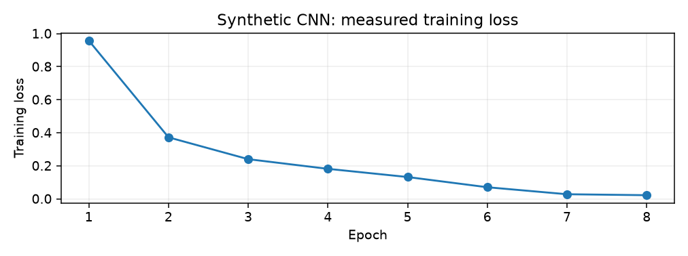
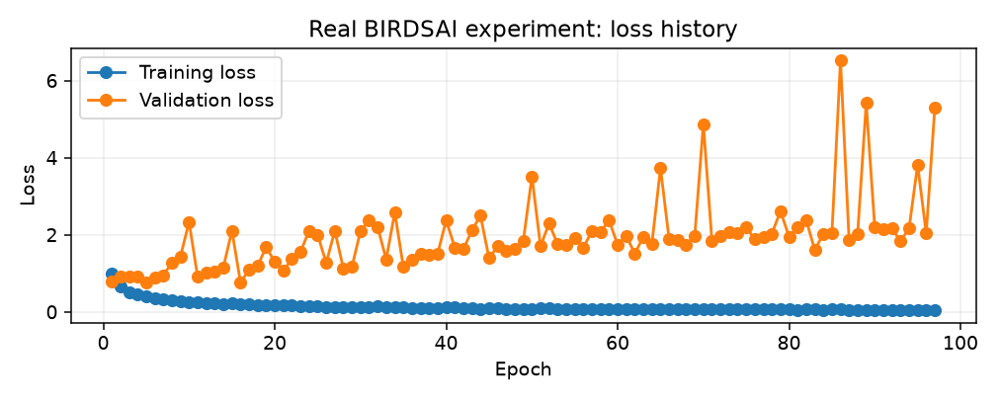
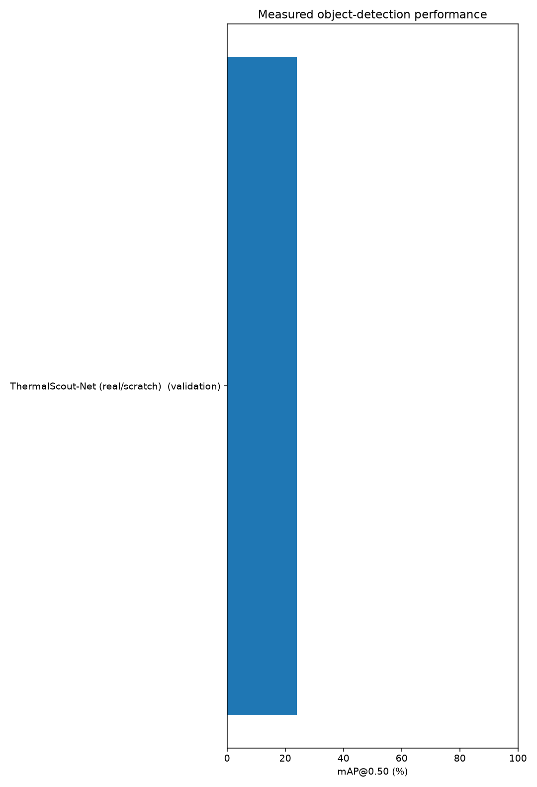
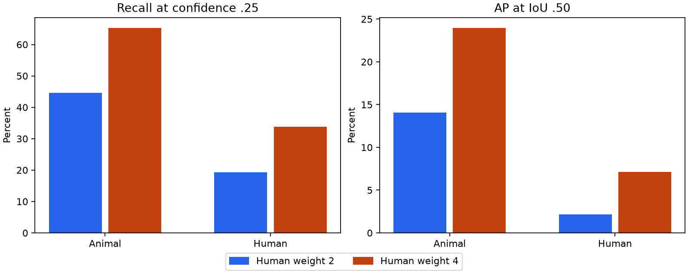

# ThermalScout-Net | Living Research Report
**Course:** COSC 2345 - Introduction to Artificial Intelligence  
**Application:** conservation and potential anti-poaching support through thermal aerial object detection.  
**Report rebuilt locally:** 2026-11-02 13:16  
**Status:** Completed: scratch/focal development evaluations and controlled threshold analysis. In progress: improving human detection and background rejection.

## 1. The problem and AI approach
The project designs and tests a custom convolutional neural network (CNN) to locate animals and people in infrared drone footage. A network learns visual representations from labeled images and predicts bounding boxes and classes. Research compares training from scratch, transfer learning, and YOLO11n. Hyperparameter search is a model-selection procedure and should not be confused with BFS or A* pathfinding.

## 2. Verified milestones
| Date | Status | Milestone | Evidence / notes |
|---|---|---|---|
| 2026-10-28 | Complete | Custom CNN prototype | Implemented a 29,635-parameter CNN in Python/PyTorch. |
| 2026-10-28 | Complete | Synthetic training | Eight epochs; training loss 0.9574 to 0.0220; three objects detected in one synthetic demonstration. |
| 2026-10-28 | Complete | BIRDSAI dataset inspection | 32 source videos and 40,661 real frames identified; annotations matched to frames. |
| 2026-10-28 | Complete | Video-separated development export | 2,001 train images and 334 validation images; 26 train videos and 6 validation videos. |
| 2026-10-28 | Not started | Custom real-image training | Train a small anchor-free custom detector from random weights. |
| 2026-10-28 | Not started | Transfer-learning experiment | Compare custom detector with pretrained feature extraction. |
| 2026-10-28 | Not started | YOLO11n baseline | Fine-tune a pretrained object detector on the same split. |
| 2026-10-28 | Not started | Held-out evaluation | Compute class-specific precision/recall, mAP@.50, mAP@.50:.95, and FPS. |

## 3. Dataset and scientific controls
- Original TrainReal: 32 sequences; 40,661 images; 74,668 animal annotations; 12,531 human annotations.
- Prepared development split: 26 train videos (2,001 images, 6,691 animal and 1,090 human labels); 6 validation videos (334 images, 954 animal and 62 human labels).
- Videos are split by sequence (not by adjacent image) to reduce data leakage.
- Official TestReal held out; not used for training or validation.
- The small validation sample has only 62 human labels: human recall will have high uncertainty.

## 4. Custom CNN demonstration (synthetic)
- Custom trainable parameters: 29,635. Trained 8 epochs on synthetic shapes.
- Training loss: 0.9574 -> 0.0220.
- A single illustrated synthetic scene had 3/3 objects detected.
- This is not a real-footage precision, recall, mAP, or generalization result.

## 5. Real-image training runs
| Timestamp | Model | Mode | Epochs | Final train loss | Best val loss |
|---|---|---|---:|---:|---:|
| 2026-10-29T12:48:01 | ThermalScout-Net (real/scratch) | quick | 2 | 1.23 | 1.51 |
| 2026-10-29T12:50:13 | ThermalScout-Net (real/scratch) | quick | 2 | 1.23 | 1.51 |
| 2026-10-29T13:39:12 | ThermalScout-Net (real/scratch) | full | 10 | 0.27 | 0.71 |
| 2026-11-02T11:48:00 | ThermalScout-Net (real/scratch) | quick | 2 | 1.23 | 1.51 |
| 2026-11-02T11:49:17 | ThermalScout-Net (real/scratch) | quick | 2 | 1.23 | 1.51 |
| 2026-11-02T11:49:17 | ThermalScout-Net (real/scratch) | quick | 2 | 1.23 | 1.51 |
| 2026-11-02T11:49:17 | ThermalScout-Net (real/scratch) | full | 10 | 0.27 | 0.71 |
| 2026-11-02T11:49:17 | ThermalScout-Net (real/scratch) | full | 10 | 0.25 | 0.60 |
| 2026-11-02T12:42:03 | ThermalScout-Net (real/scratch) | full-control | 10 | 0.27 | 0.71 |
| 2026-11-02T12:42:03 | ThermalScout-Net (real/scratch) | full-human4 | 10 | 0.30 | 0.72 |





## 6. Research comparison: measured detection scores
| Model | Training | Split | Precision | Recall | mAP@.50 | mAP@.50:.95 | FPS | Evidence |
|---|---|---|---:|---:|---:|---:|---:|---|
| ThermalScout-Net (real/scratch) (quick) | random initialization | validation | 0.1% | 1.7% | 0.0% | 0.0% | 6.66 | E:\College Work\Intro To AI\Intro to AI project\ThermalScout-Net_GitHub_Ready\ThermalScout-Net\training_runs\20261029_124654_quick\evaluation.json |
| ThermalScout-Net (real/scratch) (quick) — animal | random initialization | validation | 0.1% | 1.6% | 0.0% | 0.0% | Not measured | E:\College Work\Intro To AI\Intro to AI project\ThermalScout-Net_GitHub_Ready\ThermalScout-Net\training_runs\20261029_124654_quick\evaluation.json #class=animal |
| ThermalScout-Net (real/scratch) (quick) — human | random initialization | validation | 0.2% | 3.2% | 0.0% | 0.0% | Not measured | E:\College Work\Intro To AI\Intro to AI project\ThermalScout-Net_GitHub_Ready\ThermalScout-Net\training_runs\20261029_124654_quick\evaluation.json #class=human |
| ThermalScout-Net (real/scratch) (full) | random initialization | validation | 3.3% | 43.1% | 8.1% | 2.4% | 7.15 | E:\College Work\Intro To AI\Intro to AI project\ThermalScout-Net_GitHub_Ready\ThermalScout-Net\training_runs\20261029_125035_full\evaluation.json |
| ThermalScout-Net (real/scratch) (full) — animal | random initialization | validation | 3.2% | 44.7% | 14.1% | 4.4% | Not measured | E:\College Work\Intro To AI\Intro to AI project\ThermalScout-Net_GitHub_Ready\ThermalScout-Net\training_runs\20261029_125035_full\evaluation.json #class=animal |
| ThermalScout-Net (real/scratch) (full) — human | random initialization | validation | 6.0% | 19.4% | 2.2% | 0.5% | Not measured | E:\College Work\Intro To AI\Intro to AI project\ThermalScout-Net_GitHub_Ready\ThermalScout-Net\training_runs\20261029_125035_full\evaluation.json #class=human |
| ThermalScout-Net (real/scratch) (full) | random initialization | validation | 3.3% | 43.1% | 8.1% | 2.4% | 7.11 | E:\College Work\Intro To AI\Intro to AI project\ThermalScout-Net_GitHub_Ready\ThermalScout-Net\training_runs\20261029_133235_full\evaluation.json |
| ThermalScout-Net (real/scratch) (full) — animal | random initialization | validation | 3.2% | 44.7% | 14.1% | 4.4% | Not measured | E:\College Work\Intro To AI\Intro to AI project\ThermalScout-Net_GitHub_Ready\ThermalScout-Net\training_runs\20261029_133235_full\evaluation.json #class=animal |
| ThermalScout-Net (real/scratch) (full) — human | random initialization | validation | 6.0% | 19.4% | 2.2% | 0.5% | Not measured | E:\College Work\Intro To AI\Intro to AI project\ThermalScout-Net_GitHub_Ready\ThermalScout-Net\training_runs\20261029_133235_full\evaluation.json #class=human |
| ThermalScout-Net (real/scratch) (full) | random initialization | validation | 3.3% | 43.4% | 9.0% | 2.1% | 20.65 | D:\College Work\Intro To AI\Intro to AI project\ThermalScout-Net_GitHub_Ready\ThermalScout-Net\training_runs\20261029_focal_experiment\evaluation.json |
| ThermalScout-Net (real/scratch) (full) — animal | random initialization | validation | 3.3% | 45.8% | 17.7% | 4.1% | Not measured | D:\College Work\Intro To AI\Intro to AI project\ThermalScout-Net_GitHub_Ready\ThermalScout-Net\training_runs\20261029_focal_experiment\evaluation.json #class=animal |
| ThermalScout-Net (real/scratch) (full) — human | random initialization | validation | 3.3% | 6.5% | 0.2% | 0.0% | Not measured | D:\College Work\Intro To AI\Intro to AI project\ThermalScout-Net_GitHub_Ready\ThermalScout-Net\training_runs\20261029_focal_experiment\evaluation.json #class=human |
| ThermalScout-Net (real/scratch) (quick) | random initialization | validation | 0.1% | 1.7% | 0.0% | 0.0% | 20.14 | D:\College Work\Intro To AI\Intro to AI project\ThermalScout-Net_GitHub_Ready\ThermalScout-Net\training_runs\20261102_114742_quick\evaluation.json |
| ThermalScout-Net (real/scratch) (quick) — animal | random initialization | validation | 0.1% | 1.6% | 0.0% | 0.0% | Not measured | D:\College Work\Intro To AI\Intro to AI project\ThermalScout-Net_GitHub_Ready\ThermalScout-Net\training_runs\20261102_114742_quick\evaluation.json #class=animal |
| ThermalScout-Net (real/scratch) (quick) — human | random initialization | validation | 0.2% | 3.2% | 0.0% | 0.0% | Not measured | D:\College Work\Intro To AI\Intro to AI project\ThermalScout-Net_GitHub_Ready\ThermalScout-Net\training_runs\20261102_114742_quick\evaluation.json #class=human |
| ThermalScout-Net (real/scratch) (full-control) | random initialization | validation | 3.3% | 43.1% | 8.1% | 2.4% | 20.53 | D:\College Work\Intro To AI\Intro to AI project\ThermalScout-Net_GitHub_Ready\ThermalScout-Net\training_runs\20261102_classweight_control\evaluation.json |
| ThermalScout-Net (real/scratch) (full-control) — animal | random initialization | validation | 3.2% | 44.7% | 14.1% | 4.4% | Not measured | D:\College Work\Intro To AI\Intro to AI project\ThermalScout-Net_GitHub_Ready\ThermalScout-Net\training_runs\20261102_classweight_control\evaluation.json #class=animal |
| ThermalScout-Net (real/scratch) (full-control) — human | random initialization | validation | 6.0% | 19.4% | 2.2% | 0.5% | Not measured | D:\College Work\Intro To AI\Intro to AI project\ThermalScout-Net_GitHub_Ready\ThermalScout-Net\training_runs\20261102_classweight_control\evaluation.json #class=human |
| ThermalScout-Net (real/scratch) (full-human4) | random initialization | validation | 5.0% | 63.4% | 15.5% | 3.7% | 19.88 | D:\College Work\Intro To AI\Intro to AI project\ThermalScout-Net_GitHub_Ready\ThermalScout-Net\training_runs\20261102_classweight_human4\evaluation.json |
| ThermalScout-Net (real/scratch) (full-human4) — animal | random initialization | validation | 5.0% | 65.3% | 24.0% | 6.1% | Not measured | D:\College Work\Intro To AI\Intro to AI project\ThermalScout-Net_GitHub_Ready\ThermalScout-Net\training_runs\20261102_classweight_human4\evaluation.json #class=animal |
| ThermalScout-Net (real/scratch) (full-human4) — human | random initialization | validation | 4.1% | 33.9% | 7.1% | 1.3% | Not measured | D:\College Work\Intro To AI\Intro to AI project\ThermalScout-Net_GitHub_Ready\ThermalScout-Net\training_runs\20261102_classweight_human4\evaluation.json #class=human |



**Interpretation:** Lower training loss does not establish higher object-detection accuracy. Only enter precision, recall, mAP, and FPS after running the same evaluation protocol on an appropriate held-out split.

## 7. Risks and limitations
- Human annotations are less common than animal annotations.
- People are often only a few pixels wide; some objects are ambiguous.
- The first custom detector uses one prediction per grid cell and can miss crowded targets.
- Prototype output may show detection boxes before trustworthy benchmark metrics exist.

## 8. Next engineering actions
1. Review the checkpoint audit and controlled threshold experiment in section 11.
2. Inspect ground truth versus predictions and review the training/validation losses.
3. Run a larger scratch-training experiment and record its settings and limitations.
4. Use the existing class-wise IoU-matched evaluator and compare human recall as well as aggregate mAP.
5. Train a controlled transfer-learning model and a YOLO11n baseline on the same data.
6. Report unbiased final metrics only after the official test set is evaluated.

## 9. Course connection
COSC 2345 covers intelligent systems, search and heuristics, uncertainty, supervised learning, artificial neural networks, and responsible AI. This project emphasizes supervised learning and CNN-based perception, while using controlled model selection and evidence-based evaluation.

## 10. How this report stays current
Run `py -3.12 project_manager.py update` after each experiment or add milestones with `py -3.12 project_manager.py note --title "..." --detail "..."`. The files in this project folder update when you execute the command; nothing runs in the background.


## 11. Controlled threshold experiment — November 2, 2026

Frozen checkpoint: `20261029_focal_experiment`, epoch 7. All 334 development validation frames were evaluated on CPU without retraining. Official TestReal was not used. Training and inference defaults remain unchanged.

| Operating rule (animal / human confidence) | Precision | Recall | F1 | TP | FP | Human TP / labels |
|---|---:|---:|---:|---:|---:|---:|
| Baseline .25 / .25 | 3.30% | 43.41% | 6.14% | 441 | 12,919 | 4 / 62 |
| Global .99 / .99 | 32.44% | 25.10% | 28.30% | 255 | 531 | 0 / 62 |
| Human-preserving .99 / .25 | 28.52% | 25.49% | 26.92% | 259 | 649 | 4 / 62 |

The class-specific rule removes 94.98% of baseline false positives but loses 182 true positives. It preserves only the focal checkpoint's already-low 6.45% human recall; it does not restore the baseline-trained model's 19.35% human recall. These are validation-selected operating points, not model improvements or unbiased test results. Do not install either rule as a new default from this experiment alone.

**Control and selection.** Generated predictions once at confidence .001, then filtered the retained boxes at 20 thresholds (.001 through 1.0). IoU .50, top 500 candidates, classwise NMS at .50, and 40 detections/image were fixed. Baseline aggregate precision/recall and per-class TP/FP/GT exactly reproduced the original evaluation. The global rule maximizes validation micro F1 over the tested grid. The guarded rule maximizes that score with human confidence fixed at .25. Animal prevalence dominates micro F1. AP/mAP was not recalculated as an operating-point improvement: filtering ranked outputs does not demonstrate improved learned ranking. No speed comparison was made.

**Checkpoint audit.** The full folders `20261029_125035_full` and `20261029_133235_full` contain byte-identical checkpoint files and identical model tensors. The earlier folder lacks a loss-history CSV, so they cannot establish two independent completed training experiments. All three quick folders (`20261029_124654_quick`, `20261029_124946_quick`, `20261102_114742_quick`) have identical model tensors and loss histories. The two October files are byte-identical; November has different serialization metadata but the same learned state. Fixed seed 42 and identical quick settings can reproduce these weights; hashes alone cannot prove copying versus rerunning. The focal weights differ from all baseline and quick weights. Different FPS values do not establish different models.

The training log also contains repeated entries for the same run/history when the drive changed from E: to D:. Historical records were preserved. Registration now recognizes a matching run ID and history hash across relocated paths, preventing additional relocation duplicates. Existing totals are counts of log entries, not unique trained models. Original metrics use generic full/quick names; identify the experiment using its evidence folder.

**Diagnosis.** Of 12,919 focal false positives, overlap heuristics classify 11,627 as background-like, 1,175 localization-like, 92 duplicates and 25 wrong-class. These categories describe overlap with annotations, not visually confirmed causes. Duplicate suppression is not the dominant measured error. Code inspection shows background objectness loss is averaged separately and multiplied by .25; focal loss further downweights easy negatives. Poor background rejection/calibration is a plausible explanation, not established causation. Many false positives survive high confidence.

Training has 6,691 animal versus 1,090 human labels; validation has 954 versus 62. Class loss already weights humans by 2, so missing weighting alone is not the diagnosis. One box per stride-4 cell, first-label wins on collisions, small resized targets, argmax-only class predictions, and the shared 500-candidate/40-output caps can constrain human detection. The sweep cannot recover human boxes excluded upstream. Inspect label alignment, annotation coverage, object sizes and cap occupancy before changing training. The focal run's 4/62 human detections versus baseline 12/62 argues against selecting it solely for aggregate mAP. Per-class results and repeated controlled training seeds are needed for the next comparison.

**Evidence.** [Summary and provenance](../records/experiments/20261102_focal_threshold_sweep/summary.json), [threshold metrics](../records/experiments/20261102_focal_threshold_sweep/thresholds.csv), [class-specific policies](../records/experiments/20261102_focal_threshold_sweep/class_policies.csv), [checkpoint fingerprints](../records/experiments/20261102_focal_threshold_sweep/checkpoint_audit.json), and [validation input hashes](../records/experiments/20261102_focal_threshold_sweep/dataset_manifest.json). The summary records Python/library versions, source hashes, checkpoint hash and prediction hash. Cached predictions and BIRDSAI diagnostic images remain local and Git-ignored.

**Reproduce from the repository root.** Use Python 3.12 with the project's installed dependencies. Choose a fresh output directory; explicit `--out` refuses overwriting an existing directory.

```powershell
py -3.12 -u analyze_validation.py --run training_runs/20261029_focal_experiment --data data/processed/yolo_real --out training_runs/threshold_repeat_01
py -3.12 -m pytest tests -q
py -3.12 project_manager.py update
ii .\report\Living_Project_Report.html
```

The analysis writes `thresholds.csv`, `class_policies.csv`, `summary.json`, `checkpoint_audit.json`, `dataset_manifest.json`, the prediction cache, tradeoff plot and diagnostic images. Compare prediction hashes and counts against the saved evidence. Keep the checkpoint/data/source versions fixed. The living report includes this document each time it rebuilds, so the findings persist. Earlier analysis behavior without `--out` remains available. No retraining is needed for this experiment.

**Validation completed:** Two full inference passes produced identical prediction hashes and selected metrics. Independently applying the class thresholds reproduced 259 TP / 649 FP and 4 human TP. All eight tests passed, including relocated-history registration and class filtering. Both Markdown and HTML reports were rebuilt and checked for the experiment table.

## 12. Human and boundary diagnosis — November 2, 2026

Inspected frozen baseline and focal prediction caches on the same 334 development validation images. No retraining or defaults changed; official TestReal was not accessed. Names and letterbox-adjusted labels were checked against the current dataset, all input bytes fingerprinted, and baseline aggregate precision/recall plus class TP/FP/GT reproduced against saved evaluations.

## Controlled boundary ablation

At confidence .25 and IoU .50, compare the original retained predictions with two fixed rules: remove centers outside the exact letterboxed content rectangle, or remove centers outside that rectangle inset by four pixels on all sides at input size 256. The latter excludes real image content, including legitimate edge objects; it is a diagnostic ablation, not a recommended default. Four pixels was fixed before measuring this band, with no margin sweep.

| Model / rule | TP | FP | Precision | Recall | Human TP / 62 |
|---|---:|---:|---:|---:|---:|
| Focal / original | 441 | 12,919 | 3.30% | 43.41% | 4 |
| Focal / outside padding only | 441 | 12,911 | 3.30% | 43.41% | 4 |
| Focal / four-pixel boundary band | 439 | 6,193 | 6.62% | 43.21% | 4 |
| Baseline / original | 438 | 12,880 | 3.29% | 43.11% | 12 |
| Baseline / outside padding only | 438 | 12,878 | 3.29% | 43.11% | 12 |
| Baseline / four-pixel boundary band | 434 | 11,624 | 3.60% | 42.72% | 12 |

The focal boundary band removes 6,726 FP (52.06%) and two TP. Baseline loses 1,256 FP and four TP. Only eight focal FP centers are outside content: the visible boundary artifact is mainly just inside image content, not in the padding itself. All 1,016 label centers are inside content. This check does not establish full annotation alignment/coverage. After filtering, many false positives remain. The difference between models supports investigating focal loss and boundary features but does not establish causation. Filtering after the existing 500-candidate and 40-output caps cannot recover excluded detections; AP and speed were not measured.

## Human overlap diagnosis

For each human label, inspect retained predictions at confidence .25 and overlap IoU .50, independent of one-to-one matching:

| Model | Human-class overlap | Animal-only overlap | Neither class at .50 | Any-class overlap at .10 |
|---|---:|---:|---:|---:|
| Focal | 4 | 17 | 41 | 59 |
| Baseline | 12 | 10 | 40 | 62 |

Animal-only means at least one overlapping animal prediction and no overlapping human prediction. These are label-wise diagnostic counts, not mutually exclusive prediction assignments or proof that reclassifying animal boxes would recover every label. The .10 column overlaps the other categories. Both classification and localization/missing-candidate behavior matter. The caches cannot reveal the human alternative class score discarded by argmax or detections dropped upstream. Boundary removal does not recover any additional humans.

The two example frames are adjacent and intentionally human-heavy; they are not independent representative samples. In the new comparison, columns are labels, original predictions at .25, outside-padding filter at .25, and four-pixel boundary filter at .25. Blue is human and green is animal. Images remain Git-ignored under `training_runs/20261102_focal_boundary_final/human_padding_comparison.png`.

## Interpretation and next training experiment

Retain the original baseline as the human-detection reference. Do not replace defaults with the boundary crop or declare the focal model superior. A useful next controlled training experiment would vary class loss weight alone against baseline objectness, holding seed, data, image size, optimizer and budget fixed. Inspect human/animal box sizes and annotation mapping first; the existing human weight is already 2. Treat background rejection as a separate subsequent change. Compare both class AP and precision/recall, and report edge-object losses. This diagnostic experiment did not train a new model.

## Reproduction and evidence

Run from the repository root. Use a fresh output folder each time:

```powershell
py -3.12 diagnose_padding.py --cache records/experiments/20261102_focal_threshold_sweep/predictions.json --checkpoint training_runs/20261029_focal_experiment/thermal_scout_real_weights.pt --out training_runs/my_boundary_check
py -3.12 -m pytest tests -q
py -3.12 project_manager.py update
ii .\training_runs\my_boundary_check\human_padding_comparison.png
```

For baseline, use cache `training_runs/20261029_133235_full/error_analysis/predictions.json` and checkpoint `training_runs/20261029_133235_full/thermal_scout_real_weights.pt`. If a cache is missing, regenerate it with `analyze_validation.py` for that checkpoint first. This analysis uses the existing frozen caches; it does not independently regenerate model outputs or prove a cache/checkpoint association beyond reproducing saved metrics and recording their hashes.

[Focal evidence](../records/experiments/20261102_boundary_diagnosis/focal_summary.json) and [baseline evidence](../records/experiments/20261102_boundary_diagnosis/baseline_summary.json) include exact counts and checkpoint, source, cache and current dataset hashes. Ten tests passed, including content-rectangle boundaries and human-versus-animal overlap categories. Analysis reruns reproduced the same counts. Report section 12 persists on rebuild.

## 13. Human class-weight experiment — November 2, 2026

Tested human class weight 2 (existing default) versus 4 with animal weight fixed at 1. Both runs trained from scratch on CPU with seed 42, baseline objectness, size 256, batch 4, AdamW learning rate .001, weight decay .0001 and ten epochs. Same 2,001 training images and 334 video-separated validation images; no TestReal access. Architecture, augmentation, losses other than class weight, inference and thresholds stayed fixed. Full saved configuration comparison verified only class weight and output identity differ.

| Experiment | Selected epoch | Precision | Recall | mAP50 | mAP50:95 | Human TP/GT | Human precision | Human AP50 | Animal AP50 |
|---|---:|---:|---:|---:|---:|---:|---:|---:|---:|
| control (human weight 2) | 7 | 3.29% | 43.11% | 8.11% | 2.44% | 12/62 | 6.03% | 2.15% | 14.07% |
| human4 (human weight 4) | 7 | 4.95% | 63.39% | 15.54% | 3.70% | 21/62 | 4.09% | 7.11% | 23.97% |

Human detections changed by +9 out of 62 labels. Human recall rose from 19.35% to 33.87%, but human false positives rose from 187 to 492. Keep the existing default; this single-seed result is insufficient to adopt the variant.



View the same two human-heavy frames with `py -3.12 preview_class_weight.py`, then `ii .\training_runs\20261102_classweight_comparison.png`. Columns show labels, the weight-2 control and the weight-4 variant, all at confidence .25. Blue is human; green is animal. These adjacent, deliberately selected frames are illustrative, not representative accuracy evidence.

Checkpoint selection uses each run's minimum validation loss. Those losses are not directly comparable because class weighting differs; this evaluates the full training-plus-selection procedure. Metrics use confidence .25, IoU .50, the existing 500-candidate/40-detection cap and classwise NMS. AP uses ranked predictions at confidence floor .001. No boundary filtering or threshold tuning was applied. Small human sample, correlated video frames and one seed limit generalization; no final test accuracy claim or causal guarantee.

The new control's tensors match the historical baseline: **True**. Historical records were preserved; these two folders represent newly executed training runs, not imported checkpoints.

The two original human-heavy example frames remain difficult and still lack correct human detections. Aggregate gains occur on other frames. To view deliberately selected successes, run `py -3.12 preview_class_weight.py --gains` and open `training_runs/20261102_classweight_gains.png`. This selects the largest per-frame human TP gain from each video (up to two), not a representative sample.

## Label and size audit

Preparation script, data.yaml and loader consistently use animal=0 and human=1. Original source annotations were not independently remapped. No train/validation video overlap was found. Training has 6,691 animal and 1,090 human labels; human median minimum box side at 256 input is 4.40 pixels and 342/1,090 are under four pixels. Validation humans have median minimum side 7.60 pixels and none of 62 are under four pixels. Small training objects remain a plausible limitation; small validation-human size alone does not explain the poor recall.

Weighted cross entropy normalizes by the sum of target weights. Increasing the human weight changes relative emphasis in mixed-class batches; on human-only batches the constant weight cancels. This experiment does not multiply all human gradients by two.

## Reproduction and evidence

From the repository root, the exact two individual training commands are saved in control_config.json and human4_config.json, alongside loss histories, evaluator JSON, source hashes and logs. The dataset audit fingerprints all selected input bytes. The runner uses fixed experiment paths and refuses replacing existing checkpoints; choose fresh --out paths for repeats.

```powershell
py -3.12 -m thermalscout.train_detector --full --data data/processed/yolo_real --out training_runs/human4_repeat_01 --epochs 10 --size 256 --batch 4 --lr .001 --seed 42 --device cpu --objectness baseline --human-weight 4
py -3.12 -m thermalscout.evaluate_detector --checkpoint training_runs/human4_repeat_01/thermal_scout_real_weights.pt --data data/processed/yolo_real --out training_runs/human4_repeat_01/evaluation.json --device cpu
py -3.12 -m pytest tests -q
```

Repeat the same commands with --human-weight 2 and a separate output folder for the control. To summarize these original completed runs again: `py -3.12 summarize_class_weight.py`. To rebuild the report: `py -3.12 project_manager.py update`.

[Comparison and checkpoint hashes](../records/experiments/20261102_human_weight/comparison.json), [dataset audit](../records/experiments/20261102_human_weight/dataset_audit.json), [control configuration](../records/experiments/20261102_human_weight/control_config.json), [variant configuration](../records/experiments/20261102_human_weight/human4_config.json). Weights and BIRDSAI previews remain local under training_runs. Eleven tests passed, including unchanged default behavior, relative human-gradient effect and invalid-weight rejection.