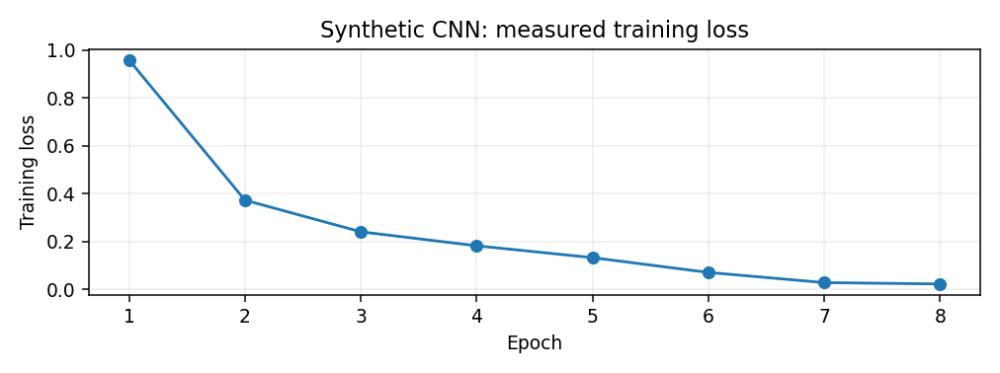
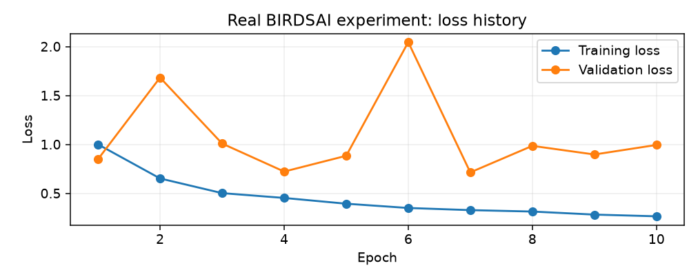
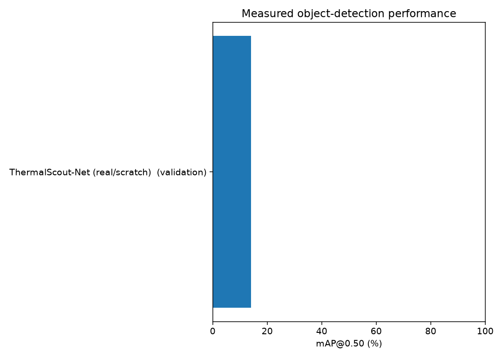

# ThermalScout-Net | Living Research Report
**Course:** COSC 2345 - Introduction to Artificial Intelligence  
**Application:** conservation and potential anti-poaching support through thermal aerial object detection.  
**Report rebuilt locally:** 2026-10-29 13:43
**Status:** Completed: synthetic CNN and BIRDSAI data preparation. In progress: real-image detector training.

## 1. The problem and AI approach
The project designs and tests a custom convolutional neural network (CNN) to locate animals and people in infrared drone footage. A network learns visual representations from labeled images and predicts bounding boxes and classes. Research compares training from scratch, transfer learning, and YOLO11n. Hyperparameter search is a model-selection procedure and should not be confused with BFS or A* pathfinding.

## 2. Verified milestones
| Date | Status | Milestone | Evidence / notes |
|---|---|---|---|
| 2026-10-28 | Complete | Custom CNN prototype | Implemented a 29,635-parameter CNN in Python/PyTorch. |
| 2026-10-28 | Complete | Synthetic training | Eight epochs; training loss 0.9574 to 0.0220; three objects detected in one synthetic demonstration. |
| 2026-10-28 | Complete | BIRDSAI dataset inspection | 32 source videos and 40,661 real frames identified; annotations matched to frames. |
| 2026-10-28 | Complete | Video-separated development export | 2,001 train images and 334 validation images; 26 train videos and 6 validation videos. |
| 2026-10-28 | Not started | Custom real-image training | Train a small anchor-free custom detector from random weights. |
| 2026-10-28 | Not started | Transfer-learning experiment | Compare custom detector with pretrained feature extraction. |
| 2026-10-28 | Not started | YOLO11n baseline | Fine-tune a pretrained object detector on the same split. |
| 2026-10-28 | Not started | Held-out evaluation | Compute class-specific precision/recall, mAP@.50, mAP@.50:.95, and FPS. |

## 3. Dataset and scientific controls
- Original TrainReal: 32 sequences; 40,661 images; 74,668 animal annotations; 12,531 human annotations.
- Prepared development split: 26 train videos (2,001 images, 6,691 animal and 1,090 human labels); 6 validation videos (334 images, 954 animal and 62 human labels).
- Videos are split by sequence (not by adjacent image) to reduce data leakage.
- Official TestReal held out; not used for training or validation.
- The small validation sample has only 62 human labels: human recall will have high uncertainty.

## 4. Custom CNN demonstration (synthetic)
- Custom trainable parameters: 29,635. Trained 8 epochs on synthetic shapes.
- Training loss: 0.9574 -> 0.0220.
- A single illustrated synthetic scene had 3/3 objects detected.
- This is not a real-footage precision, recall, mAP, or generalization result.

## 5. Real-image training runs
| Timestamp | Model | Mode | Epochs | Final train loss | Best val loss |
|---|---|---|---:|---:|---:|
| 2026-10-29T12:48:01 | ThermalScout-Net (real/scratch) | quick | 2 | 1.23 | 1.51 |
| 2026-10-29T12:50:13 | ThermalScout-Net (real/scratch) | quick | 2 | 1.23 | 1.51 |
| 2026-10-29T13:39:12 | ThermalScout-Net (real/scratch) | full | 10 | 0.27 | 0.71 |

## 6. Research comparison: measured detection scores
| Model | Training | Split | Precision | Recall | mAP@.50 | mAP@.50:.95 | FPS | Evidence |
|---|---|---|---:|---:|---:|---:|---:|---|
| ThermalScout-Net (real/scratch) (quick) | random initialization | validation | 0.1% | 1.7% | 0.0% | 0.0% | 6.66 | E:\College Work\Intro To AI\Intro to AI project\ThermalScout-Net_GitHub_Ready\ThermalScout-Net\training_runs\20261029_124654_quick\evaluation.json |
| ThermalScout-Net (real/scratch) (quick) — animal | random initialization | validation | 0.1% | 1.6% | 0.0% | 0.0% | Not measured | E:\College Work\Intro To AI\Intro to AI project\ThermalScout-Net_GitHub_Ready\ThermalScout-Net\training_runs\20261029_124654_quick\evaluation.json #class=animal |
| ThermalScout-Net (real/scratch) (quick) — human | random initialization | validation | 0.2% | 3.2% | 0.0% | 0.0% | Not measured | E:\College Work\Intro To AI\Intro to AI project\ThermalScout-Net_GitHub_Ready\ThermalScout-Net\training_runs\20261029_124654_quick\evaluation.json #class=human |
| ThermalScout-Net (real/scratch) (full) | random initialization | validation | 3.3% | 43.1% | 8.1% | 2.4% | 7.15 | E:\College Work\Intro To AI\Intro to AI project\ThermalScout-Net_GitHub_Ready\ThermalScout-Net\training_runs\20261029_125035_full\evaluation.json |
| ThermalScout-Net (real/scratch) (full) — animal | random initialization | validation | 3.2% | 44.7% | 14.1% | 4.4% | Not measured | E:\College Work\Intro To AI\Intro to AI project\ThermalScout-Net_GitHub_Ready\ThermalScout-Net\training_runs\20261029_125035_full\evaluation.json #class=animal |
| ThermalScout-Net (real/scratch) (full) — human | random initialization | validation | 6.0% | 19.4% | 2.2% | 0.5% | Not measured | E:\College Work\Intro To AI\Intro to AI project\ThermalScout-Net_GitHub_Ready\ThermalScout-Net\training_runs\20261029_125035_full\evaluation.json #class=human |
| ThermalScout-Net (real/scratch) (full) | random initialization | validation | 3.3% | 43.1% | 8.1% | 2.4% | 7.11 | E:\College Work\Intro To AI\Intro to AI project\ThermalScout-Net_GitHub_Ready\ThermalScout-Net\training_runs\20261029_133235_full\evaluation.json |
| ThermalScout-Net (real/scratch) (full) — animal | random initialization | validation | 3.2% | 44.7% | 14.1% | 4.4% | Not measured | E:\College Work\Intro To AI\Intro to AI project\ThermalScout-Net_GitHub_Ready\ThermalScout-Net\training_runs\20261029_133235_full\evaluation.json #class=animal |
| ThermalScout-Net (real/scratch) (full) — human | random initialization | validation | 6.0% | 19.4% | 2.2% | 0.5% | Not measured | E:\College Work\Intro To AI\Intro to AI project\ThermalScout-Net_GitHub_Ready\ThermalScout-Net\training_runs\20261029_133235_full\evaluation.json #class=human |

**Interpretation:** Lower training loss does not establish higher object-detection accuracy. Only enter precision, recall, mAP, and FPS after running the same evaluation protocol on an appropriate held-out split.

## 7. Risks and limitations
- Human annotations are less common than animal annotations.
- People are often only a few pixels wide; some objects are ambiguous.
- The first custom detector uses one prediction per grid cell and can miss crowded targets.
- Prototype output may show detection boxes before trustworthy benchmark metrics exist.

## 8. Next engineering actions
1. Run the packaged custom detector using `python3.13 project_manager.py train --mode quick`.
2. Inspect ground truth versus predictions and review the training/validation losses.
3. Run a larger scratch-training experiment and record its settings and limitations.
4. Implement a class-wise IoU-matched precision/recall/mAP evaluation before comparing models.
5. Train a controlled transfer-learning model and a YOLO11n baseline on the same data.
6. Report unbiased final metrics only after the official test set is evaluated.

## 9. Course connection
COSC 2345 covers intelligent systems, search and heuristics, uncertainty, supervised learning, artificial neural networks, and responsible AI. This project emphasizes supervised learning and CNN-based perception, while using controlled model selection and evidence-based evaluation.

## 10. How this report stays current
Run `python3.13 project_manager.py update` after each experiment or add milestones with `python3.13 project_manager.py note --title "..." --detail "..."`. The files in this project folder update when you execute the command; nothing runs in the background.
